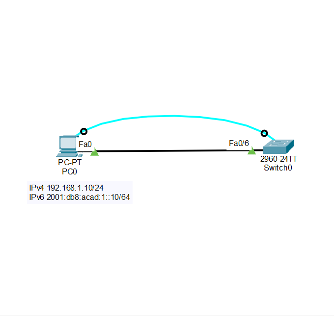

# 01 - Basic Switch Configuration

## Project Overview
This lab focuses on configuring a Cisco Layer 2 switch using Cisco IOS commands. It covers basic switch setup, management VLAN configuration, IPv4 and IPv6 addressing, remote access, and MAC address table management.

## Objectives
- Configure the switch hostname and basic security settings.
- Configure VLAN 99 for management.
- Assign IPv4 and IPv6 addresses to the switch management interface.
- Configure console and Telnet access.
- Configure switch access ports.
- Manage the MAC address table, including static MAC entries.
- Save the running configuration.

## Network Topology
The lab consists of:
- One Cisco Layer 2 switch (S1).
- One PC (PC-A).
- Ethernet and console connections.

## IP Addressing

| Device | Interface | IP Address |
|---|---|---|
| S1 | VLAN 99 | 192.168.1.2/24 |
| S1 | VLAN 99 | 2001:db8:acad:1::2/64 |
| S1 | VLAN 99 | fe80::2 (Link-Local) |
| PC-A | Network Adapter | 192.168.1.10/24 |
| PC-A | Network Adapter | 2001:db8:acad:1::10/64 |

**Default Gateway:** 192.168.1.1

## Configuration Tasks
- Basic switch configuration and hostname assignment.
- Password encryption and enable secret configuration.
- MOTD banner configuration.
- Management VLAN 99 creation and SVI configuration.
- IPv4 and IPv6 management addressing.
- Console and VTY line configuration.
- Telnet remote access configuration.
- Access port configuration.
- Static MAC address configuration and removal.
- Saving the configuration using `copy running-config startup-config`.

## Verification & Results

All configuration tasks and verification tests were completed successfully.

- IPv4 connectivity verified successfully using `ping`.
- IPv6 connectivity verified successfully using `ping`.
- Remote switch management verified successfully through Telnet.
- MAC address table inspected successfully.
- Static MAC address entry added, verified, and removed successfully.
- Switch configuration saved successfully using `copy running-config startup-config`.

All tests passed successfully in Cisco Packet Tracer.

## Key Learnings
- Understanding basic Cisco switch configuration.
- Managing a switch through a VLAN interface (SVI).
- Configuring IPv4 and IPv6 management addresses.
- Securing console and remote access.
- Understanding dynamic and static MAC address entries.

## Project Files
- `Basic-Switch-Configuration.pkt` — Cisco Packet Tracer project file.
- `topology.png` — Network topology screenshot.
- `README.md` — Project documentation.

## Tools & Technologies
- Cisco Packet Tracer
- Cisco IOS
- IPv4 and IPv6
- VLANs
- Telnet
- Ethernet

